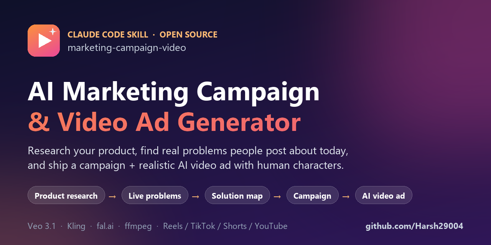
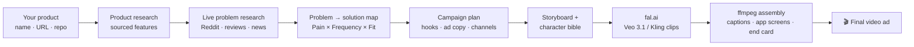

<div align="center">



# Claude Skill: AI Marketing Campaign & Video Ad Generator

**Turn any product into a research-backed marketing campaign and a realistic AI video ad with human characters, from one prompt in Claude Code.**

[](LICENSE)
[](#-install)
[](#-supported-video-models)
[](#-render-the-video)
[](https://github.com/Harsh29004/claude-ai-video-ad-generator/stargazers)

[Install](#-install) · [How it works](#-how-it-works) · [Examples](#-example-prompts) · [Video setup](#-render-the-video) · [FAQ](#-faq) · [Website](https://harsh29004.github.io/claude-ai-video-ad-generator/)

</div>

---

`marketing-campaign-video` is an open-source **Claude Code skill (Agent Skill)** that works like an AI marketing team. It researches what your product does, searches the web for **real problems people are posting about right now**, maps each problem to how your product solves it, writes the **campaign and ad copy**, and produces a **UGC-style AI video ad with lifelike human characters**. It works for Instagram Reels, TikTok, YouTube Shorts, YouTube pre-roll and LinkedIn.

No templates or generic copy: every claim is sourced, every pain point is dated, and every video shot is planned.

## ✨ What it does

| Step | What the skill does | Output |
|---|---|---|
| 1. Product research | Reads your site, app-store listing, docs and competitors | `01-product-brief.md` |
| 2. Live problem research | Mines Reddit, app-store and G2 reviews, forums and news for current pain points, with dates and links | `02-problem-research.md` |
| 3. Problem → solution map | Scores Pain × Frequency × Fit and picks the 3 strongest ad angles | `03-solution-map.md` |
| 4. Campaign plan | Big idea, positioning, hooks, Meta, TikTok, Google and LinkedIn ad copy within character limits, A/B tests, KPIs, timeline | `04-campaign-plan.md` |
| 5. AI video ad | Script, character bible, shot list → clips with **Veo 3.1 / Kling** → final cut with captions, your real app screens, end card | `05-video/final/*.mp4` |

## 🧠 How it works



### Why the videos look real
- **Character bible:** every character (age, region, wardrobe, voice) is written once and reused word for word in every shot, so the same face holds across cuts.
- **UGC realism prompting:** handheld smartphone framing, real light sources, lived-in details, natural skin texture, and **native lip-synced dialogue** in your audience's language (English, Hindi, Hinglish, Spanish…).
- **No fake UI:** AI models garble app screens, so the skill shows your **real screenshots** with a smooth zoom instead.
- **Look check first:** only the hook shot is rendered first, so you approve the character before paying for the rest.

## ⚡ Features

- 🔍 **Real-time market research**: current, dated voice-of-customer pain points, not guesses
- 🎯 **Honest problem–solution fit scoring**: no promises your product can't keep
- ✍️ **Ready-to-run ad copy** for Meta, TikTok, YouTube, Google RSA and LinkedIn, length-checked
- 🎬 **Realistic AI video ads** with human characters and lip-synced dialogue (Veo 3.1, Kling)
- 🌏 **Any market and language**: dialogue and captions in your audience's own language
- 💸 **Cost control**: dry-run cost estimate, cached clips, resumable jobs, so you never pay twice
- 📱 **All formats**: 9:16 Reels, TikTok and Shorts, 16:9 YouTube and LinkedIn, 1:1 and 4:5 feed
- 🛡️ **Compliance built in**: sourced claims, fictional characters, an AI-disclosure label (FTC and synthetic-performer rules)
- 🧩 **Zero-dependency scripts**: Python standard library + ffmpeg only

## 🚀 Install

### Option 1: Claude Code plugin (recommended, 2 commands)

```text
/plugin marketplace add Harsh29004/claude-ai-video-ad-generator
/plugin install marketing-campaign-video@harsh29004-skills
```

### Option 2: Copy the skill folder

```bash
git clone https://github.com/Harsh29004/claude-ai-video-ad-generator.git
cp -r claude-ai-video-ad-generator/skills/marketing-campaign-video ~/.claude/skills/
```

<details>
<summary>Windows (PowerShell)</summary>

```powershell
git clone https://github.com/Harsh29004/claude-ai-video-ad-generator.git
Copy-Item -Recurse claude-ai-video-ad-generator\skills\marketing-campaign-video "$HOME\.claude\skills\"
```
</details>

### Option 3: claude.ai

Download `marketing-campaign-video.zip` from [Releases](https://github.com/Harsh29004/claude-ai-video-ad-generator/releases/latest) and upload it in claude.ai's Skills settings. Research and the campaign plan work there. Rendering the video needs Claude Code on your computer.

## 💬 Example prompts

Just describe what you want. The skill triggers on its own:

```text
Make a full marketing campaign and a Reels video ad for FitPulse, our Android app that builds
20-minute home workouts from the equipment you have. Target: working people 22–35 in Indian metros.
```

```text
Build a launch campaign for our invoicing SaaS for freelancers in the US/UK. LinkedIn + YouTube
pre-roll, 16:9, 30 seconds. Make the ad feel like a real person at their desk.
```

```text
bhai meri app ke liye ek marketing campaign aur real logon wala video ad bana do, Instagram Reels ke liye
```

Or call it directly: `/marketing-campaign-video:marketing-campaign-video <product name or URL>` (plugin install), or `/marketing-campaign-video <product>` (folder install).

## 📁 What you get

```text
campaigns/fitpulse-2026-11-25/
├── 01-product-brief.md        # features, proof points, competitors (all sourced)
├── 02-problem-research.md     # live pain points with links + dates
├── 03-solution-map.md         # scored problem → feature map, top 3 angles
├── 04-campaign-plan.md        # big idea, hooks, ad copy, channels, tests, KPIs
└── 05-video/
    ├── storyboard.md          # beats, dialogue, camera, timing
    ├── shots.json             # character bible + shot prompts
    ├── prompt-pack.md         # copy-paste prompts (when you have no API key)
    ├── clips/                 # generated clips
    └── final/fitpulse-reels-v1.mp4 + .srt
```

## 🎬 Render the video

1. Install **Python 3.8+** and **[ffmpeg](https://ffmpeg.org/download.html)**.
2. Get a **fal.ai API key** (fal.ai → Dashboard → Keys) and add it to a `.env` file in your project:
   ```text
   FAL_KEY=your-key-here
   ```
3. Put your **logo** and **1–3 real app screenshots** in `05-video/assets/`.

The skill runs these for you, but you can also run them yourself:

```bash
# Free: validate the shot list and see the cost estimate
python skills/marketing-campaign-video/scripts/generate_video.py 05-video/shots.json --dry-run

# Look check: render only the hook shot first
python skills/marketing-campaign-video/scripts/generate_video.py 05-video/shots.json --only s01-hook

# Render everything (cached clips are skipped, interrupted jobs resume)
python skills/marketing-campaign-video/scripts/generate_video.py 05-video/shots.json

# Assemble: captions, app screens, end card, AI label, music → final MP4 + SRT
python skills/marketing-campaign-video/scripts/assemble_video.py 05-video/shots.json
```

**No API key?** The skill writes a `prompt-pack.md` you can paste into Google Flow (Veo), Kling, Sora or Runway. Drop the clips into `05-video/clips/` and the assembler builds the final ad.

### 🎥 Supported video models

| Model (fal.ai endpoint) | Best for | Approx. cost* |
|---|---|---|
| `fal-ai/veo3.1` (default) | Most realistic people, native lip-synced dialogue, 4–8 s shots, up to 4K | ~$0.40/s → ~$8 for a 20 s ad |
| `fal-ai/kling-video/v3/pro/text-to-video` | Longer 3–15 s shots, multi-shot, 1:1 | see fal.ai |
| `fal-ai/kling-video/v3/pro/image-to-video` | Keeping one face consistent from a reference image | see fal.ai |
| Any other fal.ai video endpoint | Set `model` and its `input` in `shots.json` | see fal.ai |

<sub>*Snapshot from Nov 2026. Check current pricing on fal.ai. The dry run always shows the estimate before you spend anything.</sub>

## 🛡️ Responsible AI

- Characters are **fictional**. Never use a real person's or celebrity's likeness without consent.
- Characters **act out a scenario**; they are never presented as real customers giving fake testimonials (US FTC 16 CFR Part 465).
- An **"AI-generated dramatization"** label is on by default (New York's synthetic-performer disclosure law and platform AI-content labels).
- Every product claim traces to a **source** found in research.

## ❓ FAQ

<details>
<summary><b>What is a Claude skill?</b></summary>

A skill (Agent Skill) is a folder of instructions, scripts and references that Claude loads when a task needs it. This one teaches Claude a full marketing workflow, from research to finished video ad. It works in Claude Code and, for the research and copy parts, on claude.ai.
</details>

<details>
<summary><b>How do I generate an AI video ad with real-looking people using Claude?</b></summary>

Install this skill, add a fal.ai key, and ask Claude: "make a video ad for &lt;your product&gt;". The skill writes the script and character bible, generates clips with Veo 3.1 or Kling, and assembles the final MP4 with captions and your real app screenshots.
</details>

<details>
<summary><b>Is it free?</b></summary>

The skill is free and open source (MIT). Research and campaign writing use your Claude plan. Video generation is paid per second by fal.ai (about $8 for a 20-second Veo 3.1 ad). Without a key you get a free prompt pack to use in any video tool.
</details>

<details>
<summary><b>Does it work for Instagram Reels, TikTok and YouTube Shorts?</b></summary>

Yes. The default is 9:16 vertical, 20–30 seconds, with captions placed clear of the platform UI. 16:9, 1:1 and 4:5 are supported too.
</details>

<details>
<summary><b>Can the characters speak Hindi, Hinglish or other languages?</b></summary>

Yes. Dialogue is written in your audience's language and Veo 3.1 lip-syncs it. Captions can use any script (set a font that covers it, e.g. Devanagari).
</details>

<details>
<summary><b>Which AI video model is best for realistic humans?</b></summary>

As of Nov 2026, Veo 3.1 gives the most realistic people with native dialogue. Kling v3 is great for longer shots and image-to-video face consistency. Both run through one fal.ai key.
</details>

<details>
<summary><b>How is this different from a generic AI ad generator?</b></summary>

It starts from real, current customer problems and your actual product, not templates. Every claim is sourced, the strongest angle is chosen by a score, and the video shows your real app.
</details>

## 🗺️ Roadmap

- [ ] Auto-generate character reference stills for image-to-video consistency
- [ ] Voice-over mode with separate TTS track
- [ ] Multi-aspect export (9:16 + 16:9 + 1:1) in one run
- [ ] Remotion template for animated captions and end cards
- [ ] More skills: landing-page copy, email sequences, social calendar

Ideas welcome: [open an issue](https://github.com/Harsh29004/claude-ai-video-ad-generator/issues).

## 🤝 Contributing

PRs are welcome. See [CONTRIBUTING.md](CONTRIBUTING.md). Good first contributions: new model presets, prompt recipes for new industries, translations, example campaigns.

## ⭐ Support

If this skill saved you time or money, **star the repo**. It helps other marketers and builders find it.

[](https://star-history.com/#Harsh29004/claude-ai-video-ad-generator&Date)

## 👤 Author

Built by **[Harsh29004](https://github.com/Harsh29004)**. Follow on GitHub for more AI marketing and Claude skills.

## 📄 License

[MIT](LICENSE). Free to use, modify and share.

<sub>Not affiliated with Anthropic, Google, Kuaishou or fal.ai. Claude is a trademark of Anthropic.</sub>
